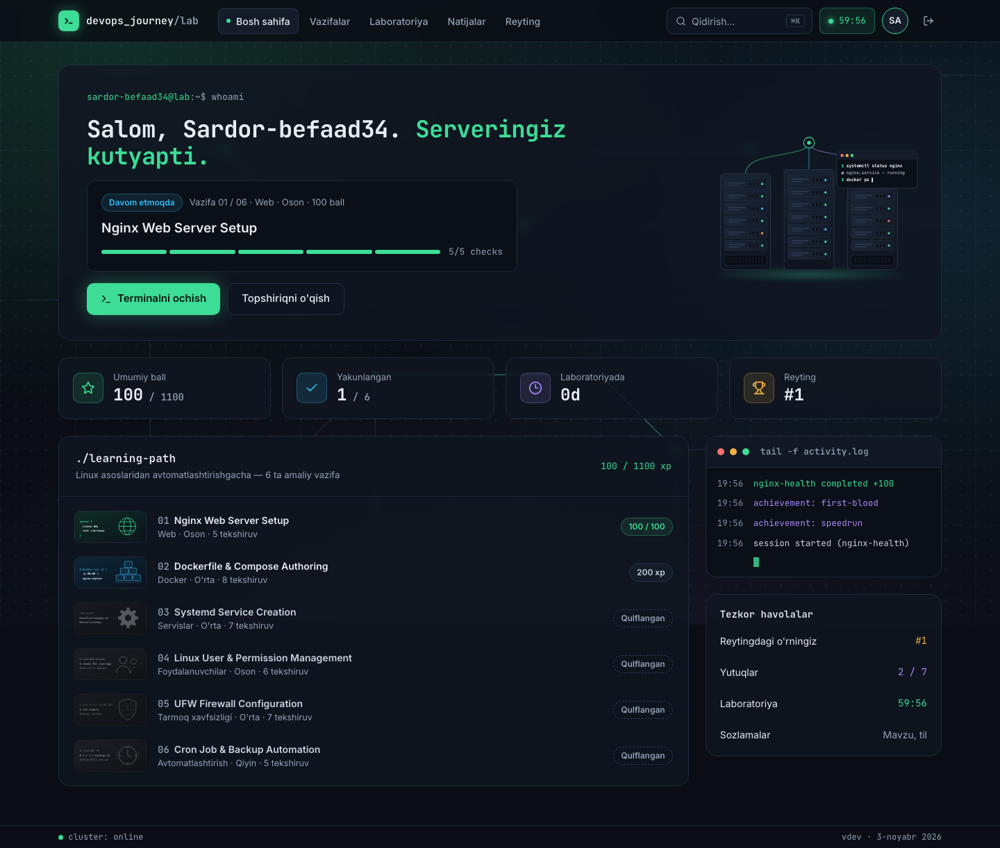
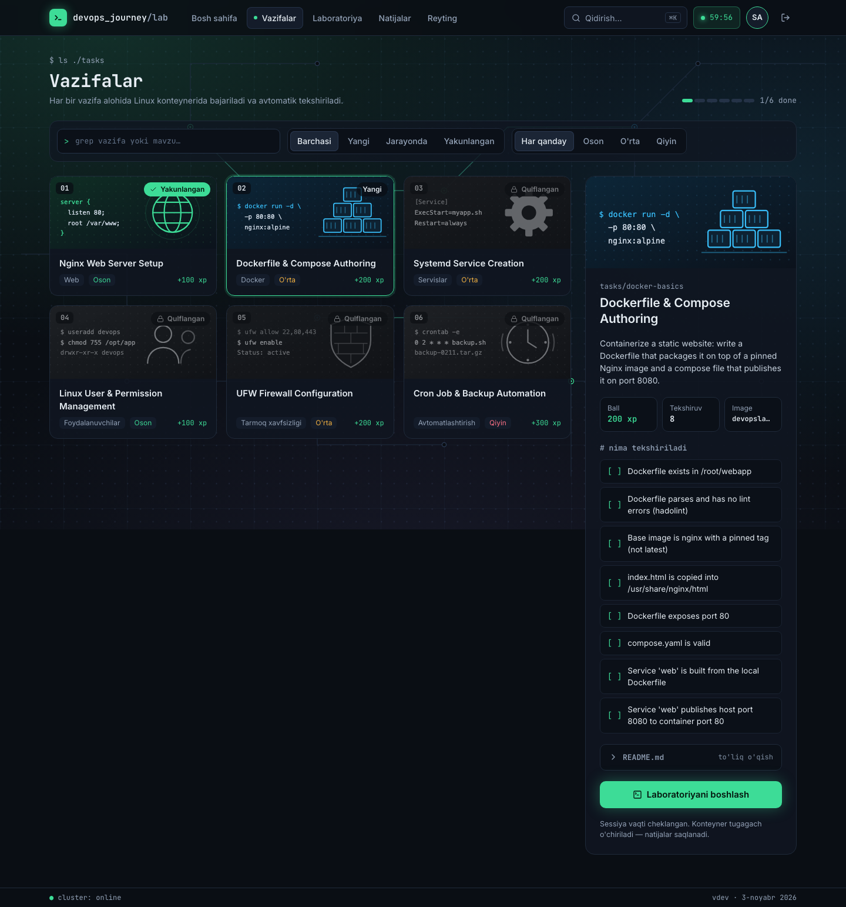
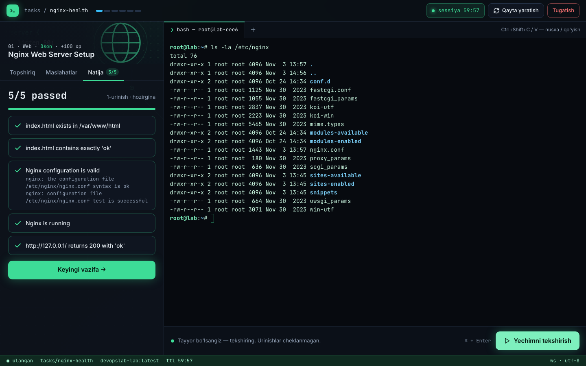
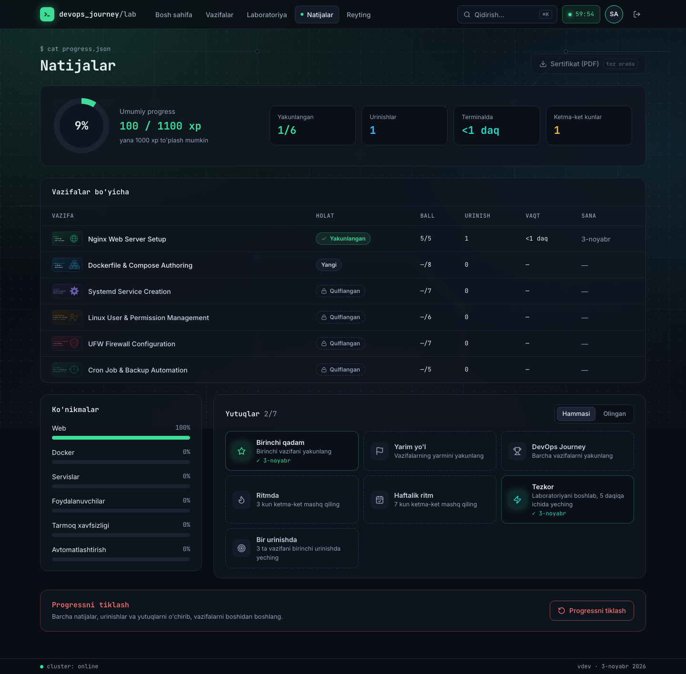
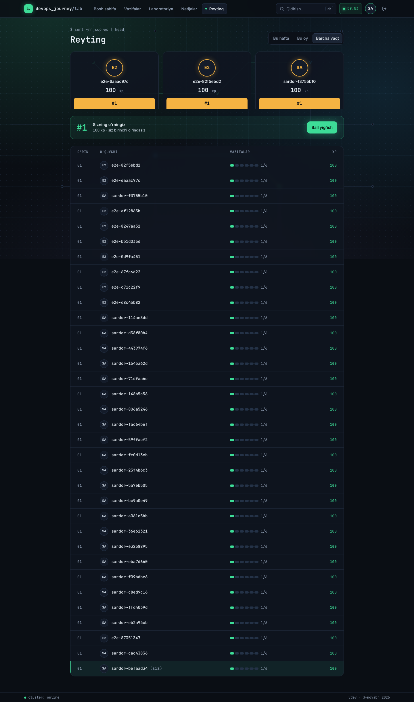
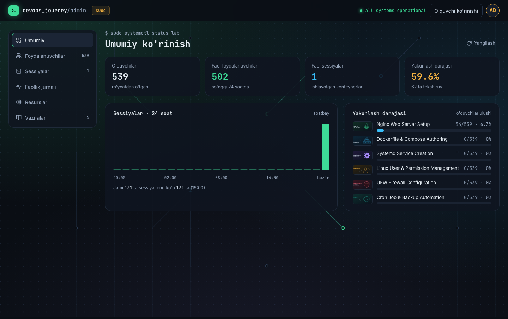
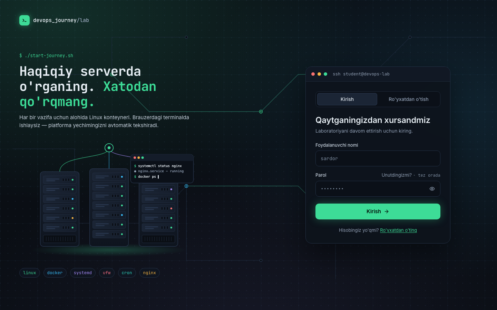
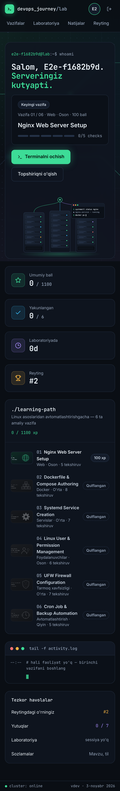
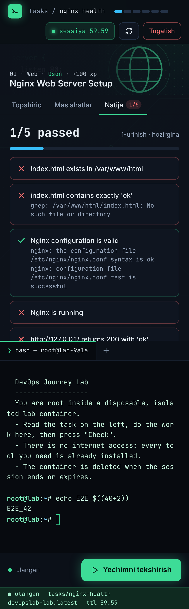

# DevOps Journey Lab

Hands-on DevOps practice in the browser. Each student gets a real Linux shell in an isolated
container, solves a task (Nginx, Docker, systemd, users, firewall, cron), and the platform checks
the result automatically.



## Features

- **Real terminal**: xterm.js over a WebSocket into a per-student container. Labs are recreated with one click.
- **Automatic checks**: every task has scripted checks with per-check feedback, hints and a reference solution.
- **Progress**: XP, streaks, skills per category, achievements and a weekly / monthly / all-time leaderboard.
- **Admin console**: users, live sessions (kill), activity log, container resources and task reload.
- **Secure by default**:
  - httpOnly cookie auth and CSRF origin checks;
  - hardened lab containers: no network, all capabilities dropped, resource limits;
  - Docker API only through a socket proxy;
  - strict CSP.

| Tasks | Lab |
|---|---|
|  |  |
| **Progress** | **Leaderboard** |
|  |  |
| **Admin** | **Login** |
|  |  |

<p align="center">
  
  &nbsp;
  
</p>

## Quick start

You need Docker with Compose v2, `make` and `openssl`.

```bash
git clone https://github.com/ismoilovdevml/devopsjourney-lab.git
cd devopsjourney-lab
make secrets   # creates .env with random secrets
make up        # builds and starts everything, including the lab image
```

Open <http://localhost:8088> and sign in as `admin`. The password is `ADMIN_PASSWORD` in `.env`.
Students register on the login page.

Stop the stack with `make down`. Run `make help` for every command.

> Postgres keeps the password it was created with. If you regenerate `.env` later, run `make clean`
> (this deletes the database) before `make up`, or the backend will fail with
> `password authentication failed`.

## Tasks

| # | Task | Topic | Level |
|---|---|---|---|
| 1 | Nginx Web Server Setup | Web | Easy |
| 2 | Dockerfile & Compose Authoring | Containers | Medium |
| 3 | Systemd Service Creation | Services | Medium |
| 4 | Linux User & Permission Management | Users | Easy |
| 5 | UFW Firewall Configuration | Network | Medium |
| 6 | Cron Job & Backup Automation | Automation | Hard |

Tasks unlock in order. Each lives in `backend-go/tasks/<id>/` as a `task.yaml` (checks, hints, points)
and a `README.md` shown to the student. Run `POST /api/admin/tasks/reload` (or the reload button in
Admin) to pick up changes.

## Stack

| Layer | Tech |
|---|---|
| Frontend | Vue 3, TypeScript, Tailwind, Pinia, xterm.js, Vite |
| Backend | Go, Gin, GORM, PostgreSQL, Redis, Docker Engine API |
| Runtime | nginx (unprivileged), docker-socket-proxy, Ubuntu 26.04 lab image |
| Tests | Go unit + integration tests, Playwright end-to-end (desktop and mobile) |

```
backend-go/     Go API, WebSocket terminal, lab runtime, tasks, lab image
frontend-vue/   Vue SPA and nginx config
e2e/            Playwright tests and reference solutions
docs/           API contract and screenshots
design/         UI design handoff
```

## Development

```bash
make secrets && make lab-image
make dev-deps                    # postgres + redis on 127.0.0.1

# backend on :8080, reusing the passwords from .env
cd backend-go
set -a; . ../.env; set +a
ENVIRONMENT=development DB_HOST=localhost REDIS_HOST=localhost go run ./cmd/server

# frontend on :5173 (proxies /api and /ws to :8080)
cd frontend-vue && npm ci && npm run dev
```

Tests:

```bash
make test                     # go vet + go test -race, frontend lint/typecheck/build
make up && make e2e           # Playwright against the running stack
scripts/smoke.sh              # quick API smoke test against the running stack
```

## Production

- Put a TLS-terminating proxy in front of port 8088. Then set:
  - `COOKIE_SECURE=true`;
  - `CORS_ORIGINS` to your HTTPS origin;
  - `NGINX_REAL_IP_FROM` to the proxy address.
- Use a dedicated host. For stronger isolation run labs under gVisor (`LAB_RUNTIME=runsc`).
  Read [SECURITY.md](SECURITY.md) before going live.
- Every setting is documented in [.env.example](.env.example). The API is described in [docs/API.md](docs/API.md).

## License

[MIT](LICENSE)
